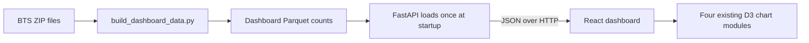

# M2 data foundation and M3 chart integration

M2 prepares count tables once from the July–September 2025 source ZIPs. The dashboard preparation script reuses the existing BTS parser and airport join, then applies the two reviewed flight-row removals and the contiguous-U.S./Alaska/Hawaii origin scope. It writes to `data/processed/2025-q3/dashboard/`; the earlier M1 files remain historical evidence.

The API keeps counts, including numerators and denominators, in its responses. A rate is calculated only after counts are summed. Zero eligible arrivals produce a `null` late rate. The airport endpoint supplies coordinates and origin totals; the context endpoint supplies carrier × weekday × local-hour counts for all origins or one origin. An unknown positive origin ID gives an empty context. Invalid IDs give HTTP 422.

React fetches metadata, airport totals and all-origin context, then mounts four existing D3 modules through small wrappers. React owns each outer container; D3 owns its SVG and tooltip descendants. The map receives airport coordinates and totals. The other three views sum count fields from context rows before deriving rates. The same D3 source is used in the notebook preview and web page. M4 added one typed selection state, selected-airport API contexts, exact time tuples, context caching and stale-response protection.

The M3 map supports wheel zoom, dragging its background to pan, and a Reset map button. Each geographic panel has its own bounded transform; the fixed map frame, legend and captions stay in place. Bubble radii are adjusted during zoom so they keep a steady size on screen. Additional airport codes appear as space opens; overlapping labels are skipped. The tooltip retains each full name and exact counts. M4 added airport selection and cross-view filtering without changing this zoom behavior.

The map alone uses D3's Viridis sequential late-arrival scale from 0% to 50%+, with values above 50% capped in color. This makes the observed airport rates easier to distinguish: 95% of airports are at or below 33.1%, while the highest small-sample rate is 83.3%. The legend uses the same function as the bubbles and labels its cap. Exact rates remain in tooltips; empty and unknown-rate marks retain separate neutral treatments. The heatmap's 0–100% palette and airline bars are unchanged.

M6 adds one startup-prepared response, `/api/airport-hours`, derived from the same count table. React fetches its 24 frames once and pads each frame with zero-count rows for the same 340 map airports. A typed reducer holds the active hour and play/pause state alongside the M4 origin and exact manual cells. The timer only advances the hour; D3 receives frame data and never fetches. Airport changes pause the timer while preserving the hour. Manual cells are suspended during playback, restored on exit, and replaced only when the user edits them. Reduced-motion users can seek without automatic playback. The map's color scale remains 0–50%+; bubble size is fixed across the 24 frames with an hourly legend.
