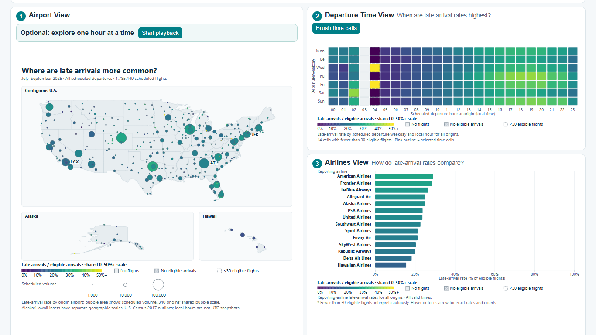
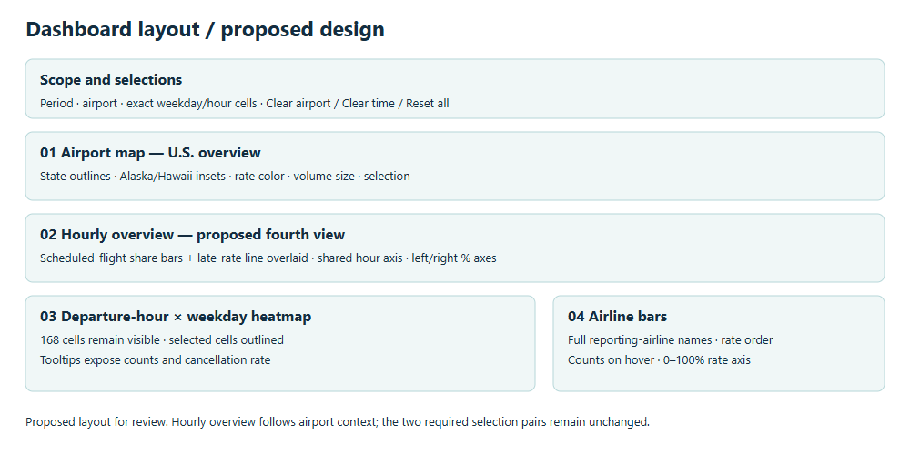

# FlightWise: Explore Flight Reliability — Late Arrivals

**Assignment 2: Interactive Visualization**  
**Student:** [Your name]  
**Status:** Draft for your review. Replace the bracketed items and export a PDF with the required filename.

## Question and data

**How did late-arrival rates differ by origin airport and scheduled departure time in July–September 2025, and how did reporting airlines compare within a selected airport and time?** FlightWise lets a viewer explore that question using the [U.S. Bureau of Transportation Statistics (BTS) Reporting Carrier On-Time Performance data](https://www.transtats.bts.gov/DL_SelectFields.aspx?QO_fu146_anzr=b0-gvzr&gnoyr_VQ=FGJ). BTS describes this table as monthly records of nonstop domestic flights operated by reporting carriers. I joined the flight records to BTS's [Master Coordinate airport table](https://transtats.bts.gov/DL_SelectFields.aspx?QO_fu146_anzr=N8vn6v10+f722146+gnoyr5&gnoyr_VQ=FLL) using historical airport identifiers so the map could place origins geographically. The dashboard covers 340 origin airports in the contiguous United States, Alaska, and Hawaii and 14 reporting airlines. Destinations are not restricted to those regions.

The displayed scope has **1,785,449 scheduled flights**. Arrival lateness means at least 15 minutes late among completed, non-diverted flights with a known arrival outcome: **401,327 late arrivals among 1,754,276 eligible arrivals (22.9%)**. A missing arrival outcome is never counted as on time. Cancellation and diversion counts remain available in details, but their percentages use scheduled flights as the denominator. The time dimension is the *scheduled local departure hour at each origin*, not actual departure time or one shared UTC clock.

## Views and design choices

The first view is an airport map, the second is a weekday-by-hour heatmap, and the third compares reporting airlines. This order moves from geography to departure-time pattern to carrier detail. On a laptop-sized screen the three linked views sit together: the map is on the left, with the heatmap and airline bars on the right. A full-width fourth view below them shows scheduled-flight share as bars and late-arrival rate as a line across all 24 local hours. The fourth view keeps all weekdays even when heatmap cells are selected, giving the filtered airline comparison an all-hour reference.

On the map, position identifies the airport, bubble area shows scheduled volume, and a smooth Viridis colour scale shows late-arrival rate from 0% to 50%+. Values above 50% keep their exact rates in the tooltip. The heatmap and airline bars use the same rate-colour scale; airline bar *length* uses a fixed 0–100% rate axis. Alaska and Hawaii have labelled geographic insets. Zoom opens space to reveal more airport codes without enlarging bubbles. I chose this over a dense scatterplot because geography and airport names make the first selection easier to interpret. Pink outlines indicate selection rather than another rate value. Cells with no flights, flights but no eligible arrivals, and fewer than 30 eligible arrivals have distinct marks. The fourth view uses pale teal bars and a teal line to distinguish two measures, with separately labelled percentage axes; those axes rescale with airport context. The two panels in optional airport comparison hold matching axes for direct comparison.

*Figure 1. The map, heatmap, and airline bars are visible together. Replace this capture if the final UI changes.*

*Figure 2. An early digital layout proposal; replace it with your photographed design sketch if you have one.*

## Coordination and an example exploration

**Pair 1: airport map → heatmap.** Selecting a map bubble changes the heatmap's data to flights from that origin. The map keeps all airports visible and marks the selected one, so the geographic context is not lost. The airline and all-hour views also receive the selected airport, but that is the same airport-source relationship, not a second required pair.

**Pair 2: heatmap → airline bars.** Clicking cells or brushing a rectangle selects exact weekday/hour tuples. The bars then aggregate only flights in those tuples within the current airport. Several clicked cells form a union of exact tuples; they do not accidentally include every combination of the chosen weekdays and hours. The heatmap retains all 168 cells for context. A selection summary, pink outlines, Clear airport, Clear time, and Reset all make the state visible and reversible. Map bubbles and heatmap cells also work with keyboard focus and Enter or Space. Airport changes request a new context from the server; time filtering happens in the browser so brushing does not generate a stream of requests. Loading, empty, and retryable error states are visible.

For one reproducible path, selecting **ATL** reveals an all-weekday late-arrival rate of **9.2% at 08:00** (580 of 6,300 eligible arrivals) versus **33.5% at 18:00** (1,258 of 3,755). Selecting the two disjoint cells **Monday 08:00 and Friday 17:00** gives the airline chart **352 late arrivals among 1,517 eligible arrivals (23.2%)** at ATL. Delta accounts for 1,226 of those eligible arrivals, illustrating why counts matter when comparing airline bars. These are descriptive results for this quarter and this origin; flight routes, schedules, and carrier mix differ, so the rates do not establish that a time or airline *causes* lateness.

## Architecture, process, and limitations

The acquisition and preprocessing scripts retain source provenance and prepare count tables. A FastAPI backend loads those tables once at startup and serves metadata, airport totals, airport-specific carrier/weekday/hour counts, and 24 optional playback frames as JSON. React holds the shared selection state and fetches coarse airport contexts; D3 code draws the interactive SVG charts from the returned counts. Numerators and denominators are summed before rates are calculated. Context responses are cached by data version, and obsolete requests are cancelled or ignored. The project currently runs on **localhost**; the README gives the install, preparation, and start commands for both halves.

The design changed after review: map zoom was adjusted so bubbles stay readable, the rate colours were unified across the three linked views, and the layout was rearranged to keep their updates visible together. I spent approximately **[insert your actual development hours]** on the project. The most time-consuming part for me was **[your honest account of the hardest task and what you changed]**. The dashboard is historical, not a prediction or live flight tracker. It covers one quarter, scheduled local hours, and reporting carriers rather than ticket-selling brands; small samples and missing outcomes limit some comparisons.

I used **OpenAI Codex** for planning, code assistance, testing, and draft documentation. I reviewed the dashboard and requested revisions to its scope, layout, colours, and controls. **[Edit this sentence to describe your own review of the final code and report accurately.]**

## Extra Credit Features

The historical-hour playback advances through 00:00–23:00 profiles from this same quarter. It updates the map, marks the heatmap's active hour, and updates airline bars; a slider, Pause/Replay, reduced-motion support, and restoration of manually selected cells make it more than a simple animation. The separate two-airport comparison lets me pin one airport and select another, then inspect their 24-hour profiles side by side with matching scheduled-share and late-rate axes. Dashed and solid pink map rings identify the two airports. These features go beyond the two required links, but neither implies a live chronological day or guarantees bonus points.

## References

- [BTS Reporting Carrier On-Time Performance data](https://www.transtats.bts.gov/DL_SelectFields.aspx?QO_fu146_anzr=b0-gvzr&gnoyr_VQ=FGJ); downloaded July, August, and September 2025 archives are recorded with hashes in `data/manifest.json`.
- [BTS Master Coordinate airport table](https://transtats.bts.gov/DL_SelectFields.aspx?QO_fu146_anzr=N8vn6v10+f722146+gnoyr5&gnoyr_VQ=FLL).
- [U.S. Atlas](https://github.com/topojson/us-atlas), which redistributes 2017 U.S. Census state boundaries as TopoJSON for the map background.

**Before PDF export:** replace bracketed text with your own name, hours, and reflection; replace Figure 2 with your photographed sketch if available; check the final word count against the assignment's approximately 600–1,200-word target; use the required `LastName_FirstName_A2_report.pdf` filename. This draft is not the submitted PDF.
